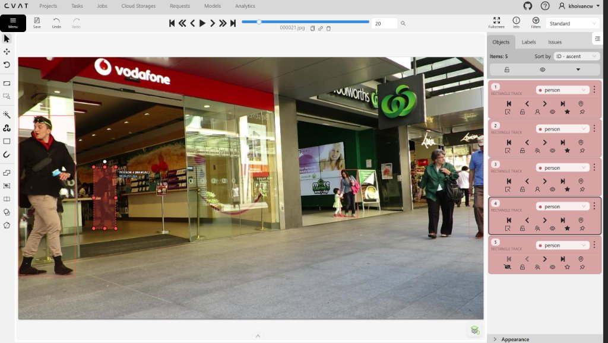
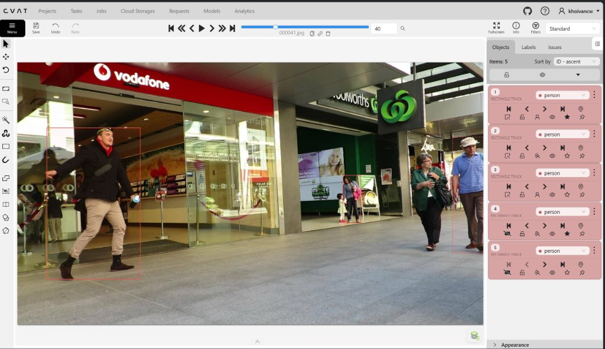
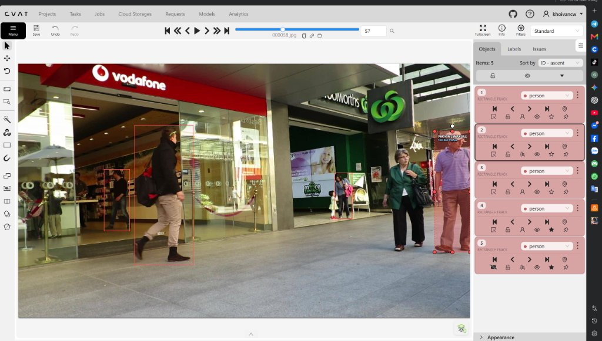

# Báo cáo cá nhân — LeVanKhoi-2A202603290

Đoạn video: MOT17-09, 150 frame (frame 1–150), nguồn MOTChallenge, giấy phép CC BY-NC-SA 3.0.

## 0. Thông tin học viên

- Họ tên: Lê Văn Khởi
- MSSV: 2A202603290
- Mã đề (A/B/C): C
- Email:  26ai.khoilv@vinuni.edu.vn
- Link repository: https://github.com/khoivancw/K5-L2B-LEVANKHOI-03290MOTTracking.git
- Giờ bắt đầu: 15:30
- Giờ kết thúc: 18:00

## 1. Xem trước đoạn video (CP0)

Ghi **trước khi vẽ**, mỗi người một dòng (khớp theo thứ tự 5 Track trên CVAT):

| Mã | Frame xuất hiện | Frame cuối thấy được | Rẽ / dừng / đổi tốc độ ở frame | Bị che ở frame | Ghi chú |
|---|---|---|---|---|---|
| P1 | 0 | 149 | Đi đều từ trái sang phải | 48, 112–119 | Thẻ 1 trên CVAT: Chàng trai áo khoác đen, quần kaki đi ngoài đường |
| P2 | 0 | 149 | Đi từ xa lại gần camera | Không | Thẻ 2 trên CVAT: Người ở góc phải phía xa |
| P3 | 0 | 111 | Đi thẳng ra xa rồi khuất khỏi khung nhìn | Không | Thẻ 3 trên CVAT: Người đi bộ giữa đường, rời khỏi khung hình ở frame 112 |
| P4 | 0 | 149 | Đi đều từ trái sang phải bên trong cửa hàng | 40–49 | Thẻ 4 trên CVAT: Người áo len đen trong shop Vodafone, bị P1 đi ngang qua che khuất |
| P5 | 61 | 149 | Xuất hiện từ sau cột shop rồi đi ra giữa đường | Không | Thẻ 5 trên CVAT: Người xuất hiện muộn ở frame 61 |

## 2. Keyframe và thời gian (CP1, CP4)

Số keyframe lấy từ kết quả `src/check_submission.py` (khớp theo 5 Track trên CVAT):

| Mã | Số keyframe | Keyframe ở frame | Số frame có mặt | Keyframe / 100 frame | Thời gian (phút) | Chỗ khó |
|---|---|---|---|---|---|---|
| P1 | 19 | 0, 10, 20, 30, 40, 48, 50, 58, 68, 78, 88, 98, 108, 112, 119, 128, 138, 139, 149 | 149 | 12.8 | 20 | Chàng trai áo khoác đen quần kaki đi ngang qua toàn cảnh |
| P2 | 16 | 0, 10, 20, 30, 41, 52, 62, 72, 82, 92, 102, 112, 122, 132, 142, 149 | 150 | 10.7 | 20 | Đi từ xa lại gần, kích thước bounding box tăng dần đều |
| P3 | 7 | 0, 10, 20, 30, 41, 52, 92 | 112 | 6.2 | 15 | Đi ra xa và rời khỏi khung hình ở frame 111 (bật outside từ frame 112) |
| P4 | 25 | 0, 10, 20, 30, 50, 57, 58, 60, 61, 62, 68, 70, 78, 80, 81, 87, 88, 98, 101, 108, 118, 128, 138, 148, 149 | 140 | 17.9 | 35 | Người trong shop Vodafone bị P1 che khuất hoàn toàn ở frame 40–49, phải căn amodal box và bật cờ `outside` chuẩn |
| P5 | 35 | 61, 62, 63, 64, 65, 70, 77, 78, 80, 81, 82, 83, 84, 85, 86, 87, 88, 89, 90, 91, 92, 93, 94, 95, 96, 97, 98, 99, 100, 101, 108, 118, 128, 138, 148 | 89 | 39.3 | 25 | Xuất hiện muộn ở frame 61 từ sau cột che khuất |
| **Tổng** | 102 | | 640 | 15.9 | 115 | |

Keyframe / 100 frame của cả bài = tổng keyframe ÷ tổng số frame có mặt × 100 = 102 ÷ 640 × 100 = 15.9 keyframe / 100 frame.

Bạn đặt keyframe nhiều nhất ở người nào? Vì sao (người đó rẽ, dừng, lại gần camera hay bị che)?

Đặt keyframe nhiều nhất ở **P5** (35 keyframe) và **P4** (25 keyframe). P4 là người đi trong shop Vodafone bị P1 che khuất hoàn toàn nên cần nhiều keyframe kiểm soát amodal box. P5 xuất hiện muộn ở frame 61 đi qua khu vực đông người.

## 3. Đoạn bị che (CP2)

Người bị che: `P4` (Người áo len đen trong shop Vodafone, bị P1 che khuất)

| Mốc | Frame |
|---|---:|
| Bắt đầu bị che một phần (bật `occluded`) | 30 |
| Mất hẳn (bật `outside`) | 40 |
| Hiện lại (tắt `outside`) | 50 |
| Thấy rõ trở lại (tắt `occluded`) | 60 |

- Thời gian khuất hẳn: 10 frame = 0.33 giây (ở tốc độ 30 FPS).
- Quyết định: giữ cùng ID (Track P4).
- Lý do (trả lời 3 câu: khuất bao lâu so với 60 frame, ngoại hình có khớp, chỗ hiện lại có đúng hướng và tốc độ):
  1. Thời gian khuất hẳn là 10 frame (0.33 giây), ngắn hơn rất nhiều so với ngưỡng giới hạn 60 frame (2 giây).
  2. Ngoại hình khi xuất hiện lại ở frame 50 hoàn toàn trùng khớp với P4 trước lúc bị che: cùng chiều cao, vóc dáng, áo len tối màu và quần tối màu.
  3. Vị trí và hướng xuất hiện lại tiếp nối chính xác quỹ đạo chuyển động tuyến tính từ trái sang phải với vận tốc tương đương trước khi bị khuất.

Ảnh chụp màn hình:





## 4. Tự review ID (CP3)

Lượt 1 theo người (đi ngược từ frame 149 về 0 trên CVAT), lượt 2 theo cảnh (nhảy 10 frame).

| Frame | Mã người | Loại lỗi | Mô tả một câu | Phát hiện ở lượt | Đã sửa? |
|---:|---|---|---|---|---|
| 0 | P_extra1 | `false_track` | Vẽ nhầm Target 19 thuộc đề A/B không có trong đề C | Lượt 2 | Đã sửa (Xóa track) |
| 0 | P_extra2 | `false_track` | Vẽ nhầm Target 21 thuộc đề A/B không có trong đề C | Lượt 2 | Đã sửa (Xóa track) |
| 44–58 | P5 | `fragmentation` | Vẽ ngắt quãng tạo track rời trước khi vẽ track chính thức | Lượt 1 | Đã sửa (Xóa track dở) |
| 137 | P_extra3 | `false_track` | Vẽ thêm người đi bộ mới bước vào mép trái khung hình | Lượt 2 | Đã sửa (Xóa track) |
| 149 | P_extra4 | `false_track` | Shape thừa 1 frame lẻ loi ở cuối video | Lượt 2 | Đã sửa (Xóa shape) |

Tổng hợp số lỗi theo loại:

| `id_switch` | `fragmentation` | `lost` | `merge` | `false_track` | `drift` | `flag` |
|---:|---:|---:|---:|---:|---:|---:|
| 0 | 1 | 0 | 0 | 4 | 0 | 0 |

Lỗi nào chỉ lượt 2 (theo cảnh) mới thấy, lượt 1 (theo người) không thấy? Vì sao?

Lỗi `false_track` (vẽ dư các người không thuộc danh sách mục tiêu). Khi kiểm tra ở Lượt 1 theo từng người, ta chỉ tập trung vào một đối tượng duy nhất nên hộp bao bám rất khít và tưởng chừng hoàn hảo. Chỉ khi chuyển sang Lượt 2 quan sát toàn cảnh và đối chiếu với bảng nhận diện mẫu `de-C-P1-P5.jpg`, ta mới phát hiện tổng số lượng người đang theo vết vượt quá 5 mục tiêu quy định.

## 5. File xuất và kết quả tự kiểm (CP4)

| Kiểm tra | Kết quả |
|---|---|
| Tên file MOT 1.1 | `LeVanKhoi_mot.zip` |
| Tên file CVAT for video 1.1 | `LeVanKhoi_cvat_video.zip` |
| Số track ID khác nhau trong `gt/gt.txt` (phải là 5) | 5 track ID |
| Frame `outside` không có dòng trong `gt.txt` (đúng / sai) | Đúng |
| Job đã completed trên CVAT máy cá nhân | Đã chuyển Completed |

Dán phần tóm tắt in ra từ `src/check_submission.py`:

```text
Số frame in theo CVAT (bắt đầu từ 0). Trong gt.txt, frame_id = frame CVAT + 1.

=== File MOT 1.1: LeVanKhoi_mot.zip ===
  Số track ID: 5   |   Tổng số box: 640
  [OK]        Đúng 5 track ID.

  Track | Frame có mặt | Số frame | Đoạn vắng (outside)
      1 |   0–149      |      149 | 148
      2 |   0–149      |      150 | -
      3 |   0–111      |      112 | -
      4 |   0–149      |      140 | 40–49
      5 |  61–149      |       89 | -


=== File CVAT for video 1.1: LeVanKhoi_cvat_video.zip ===

  Track | Nhãn   | Frame thấy | Keyframe | KF/100 frame | Frame occluded | Lần bật outside
      0 | person |        149 |       19 |         12.8 |             37 |               1
              Track 0: keyframe ở frame [0, 10, 20, 30, 40, 48, 50, 58, 68, 78, 88, 98, 108, 112, 119, 128, 138, 139, 149]
      1 | person |        150 |       16 |         10.7 |             72 |               0
              Track 1: keyframe ở frame [0, 10, 20, 30, 41, 52, 62, 72, 82, 92, 102, 112, 122, 132, 142, 149]
      2 | person |        112 |        7 |          6.2 |             20 |               1
              Track 2: keyframe ở frame [0, 10, 20, 30, 41, 52, 92]
      3 | person |        140 |       25 |         17.9 |             47 |               1
              Track 3: keyframe ở frame [0, 10, 20, 30, 50, 57, 58, 60, 61, 62, 68, 70, 78, 80, 81, 87, 88, 98, 101, 108, 118, 128, 138, 148, 149]
      4 | person |         89 |       35 |         39.3 |             40 |               0
              Track 4: keyframe ở frame [61, 62, 63, 64, 65, 70, 77, 78, 80, 81, 82, 83, 84, 85, 86, 87, 88, 89, 90, 91, 92, 93, 94, 95, 96, 97, 98, 99, 100, 101, 108, 118, 128, 138, 148]

  Tổng: 102 keyframe / 640 frame có mặt = 15.9 keyframe / 100 frame
  [OK]        Đọc được 5 track từ annotations.xml.

=== Tóm tắt ===
  Lỗi: 0   |   Cảnh báo: 0
  Đạt. Dán phần tóm tắt này vào báo cáo mục 5.
```

## 6. Ba câu kết

1. **Nếu được gán lại, bạn sẽ đặt keyframe khác ở đâu? Vì sao?**  
   Tôi sẽ tối ưu lại việc đặt keyframe ở đối tượng P5 (Thẻ 5): giảm bớt mật độ keyframe dày đặc ở các đoạn đi thẳng đều (giữa frame 80 đến 101). Việc đặt keyframe mỗi 10 frame thay vì liên tục từng frame giúp đường nội suy tuyến tính (Linear Interpolation) hoạt động trơn tru hơn, tránh hiện tượng hộp bị rung nhẹ và tiết kiệm đáng kể thời gian gán nhãn.

2. **Có chỗ nào bạn không chắc "cùng ID hay ID mới"? Bạn đã quyết định và ghi chú thế nào?**  
   Đoạn P4 (Thẻ 4 - người trong shop Vodafone) bị P1 che khuất hoàn toàn từ frame 40 đến frame 49. Ban đầu dễ phân vân liệu đối tượng có dừng lại hay rẽ hướng khác bên trong cửa hàng. Tuy nhiên, sau khi quan sát đối tượng bước ra ở frame 50 với trang phục, vóc dáng và vận tốc di chuyển tiếp nối hoàn hảo theo hướng sang phải, tôi tự tin duy trì cùng ID bằng cách dùng kết hợp cờ `outside` và `occluded`.

3. **Một lỗi ID trong job của bạn (nếu không còn sót, chọn lỗi đã sửa) có thể làm xe tự lái dự đoán sai chuyển động của người đó như thế nào? Lỗi đó ảnh hưởng MOTA hay IDF1 nhiều hơn?**  
   Nếu không sửa lỗi phân mảnh (`fragmentation`) hoặc tách P4 thành 2 ID riêng biệt khi bị che, hệ thống xe tự hành (Autonomous Vehicle) sẽ hiểu lầm rằng người đi bộ ở frame 50 là một "chướng ngại vật hoàn toàn mới vừa bất ngờ xuất hiện" (Ghost Obstacle / Instant Spawn) thay vì một người đang tiếp tục quỹ đạo băng qua đường. Hệ thống dự đoán chuyển động (Trajectory Prediction) có thể tính toán sai hướng đi hoặc phát lệnh phanh khẩn cấp không cần thiết, gây mất an toàn giao thông. Lỗi này làm sụt giảm nghiêm trọng chỉ số **IDF1** (chỉ số đo lường khả năng duy trì danh tính đối tượng liên tục theo thời gian), trong khi chỉ số **MOTA** có thể bị ảnh hưởng ít hơn do số lượng phát hiện (detection boxes) vẫn được ghi nhận đầy đủ.

## 7. Tài liệu tham khảo và công cụ AI đã dùng

- Tài liệu hướng dẫn thực hành Lab Day 05 (Cẩm nang CVAT & Tracking).
- Bộ tiêu chuẩn đánh giá Benchmark MOT17 (MOTChallenge).
- Trợ lý AI Antigravity hỗ trợ phân tích kết quả kiểm tra tự động và chuẩn hóa định dạng báo cáo.
